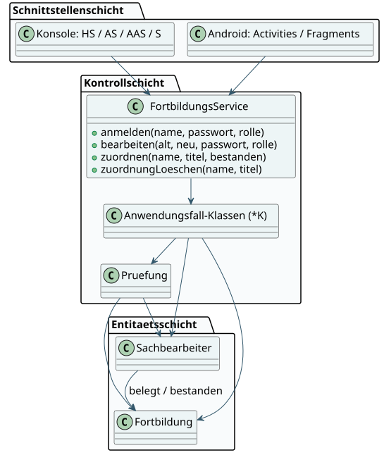
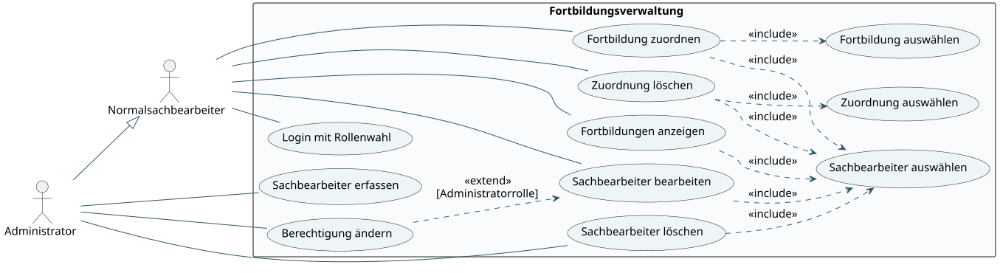

# Fortbildungsverwaltung

Verwaltung von Sachbearbeitern und ihren Fortbildungen – als **Java-Konsolenanwendung** und als **Android-App**, beide auf derselben Fachlogik. Dazu eine eigenständige **Android-Albumverwaltung** mit ViewModel, LiveData und DataBinding.

Entstanden im Modul *User Interfaces* an der Hochschule Furtwangen (Aufgabenblätter 01–11).

## Funktionen

- **Login mit Rollenwahl:** Administrator oder Normalsachbearbeiter; die Menüs zeigen nur die erlaubten Aktionen.
- **Sachbearbeiter verwalten:** erfassen, bearbeiten, löschen (mit Ja/Nein-Bestätigung) und Berechtigungen ändern – Erfassen, Löschen und Rechteänderung nur als Administrator.
- **Fortbildungen zuordnen:** belegte und bestandene Fortbildungen zuordnen, anzeigen und löschen; Voraussetzungen zwischen Fortbildungen werden geprüft.
- **Validierung:** eindeutige Benutzernamen, Passwortregeln, fehlgeschlagene Änderungen lassen die Daten konsistent.
- **Speicherung:** die Konsole speichert in `Entitaeten.ser`, die Android-App im privaten App-Verzeichnis. Beschädigte Dateien werden nicht still überschrieben.
- **Album-App:** Album auswählen, bearbeiten, übernehmen oder verwerfen; eigenes Layout für Hoch- und Querformat.

## Architektur

Drei Schichten: Die Oberflächen (Konsole und Android) sprechen nur mit der Kontrollschicht, die Anwendungsfälle prüft und die Entitäten `Sachbearbeiter` und `Fortbildung` koordiniert. So nutzen Konsole und Android-App dieselbe Fachlogik (Gradle-Modul `core`).





Weitere UML-Diagramme (Szenemodell, Klassen-, Entitäts- und Sequenzdiagramme) liegen als SVG mit PlantUML-Quellen in [`dokumentation/diagramme`](dokumentation/diagramme). Die ausführliche Dokumentation mit Oberflächenentwürfen steht in [`dokumentation/Dokumentation.html`](dokumentation/Dokumentation.html).

## Technik

| Bereich | Technologie |
|---|---|
| Fachlogik & Konsole | Java 17 |
| Android | Activities, Fragments, ViewModel, LiveData, DataBinding, SavedStateHandle |
| Build | Gradle 8.9 (Wrapper), Android Gradle Plugin 8.7.3, Android SDK 35, min. Android 8.0 |
| Tests | eigene Regressions- und Service-Tests, Python-Konsolenszenarien, JUnit, Espresso |
| Modellierung | UML mit PlantUML |

## Konsole starten

JDK 17 oder neuer installieren, im Projektordner ausführen:

```sh
java -jar dist/fortbildungsverwaltung-console.jar
```

Erstanmeldung: `admin`, Passwort `aaAA11&&aa`, Rolle Administrator wählen.
Das Passwort anschließend über die Benutzerbearbeitung ändern. Bei Bearbeitung
bedeutet ein leeres Passwortfeld: bisheriges Passwort behalten.
Die Konsole speichert beim Beenden/EOF in `Entitaeten.ser` im Arbeitsverzeichnis.

Alternativ aus den Quellen bauen:

```sh
mkdir build
javac -encoding UTF-8 -d build fortbildungsverwaltung/*.java
java -cp build fortbildungsverwaltung.FortbildungsverwaltungHS
```

## Android-Apps

Zwei vorgebaute Debug-APKs liegen in `dist`:

- `fortbildungsverwaltung-debug.apk`: Benutzer, Rollen und Fortbildungszuordnungen.
- `albumverwaltung-debug.apk`: Album-Auswahl, Bearbeitung, Apply/Cancel und Querformat.

Mindestversion Android 8.0 (API 26). Die APKs sind nur zum lokalen Testen signiert.

In Android Studio den Ordner `android` öffnen. Den gesamten Projektbaum behalten,
weil das Modul `core` auf die gemeinsamen Java-Quellen daneben verweist.
SDK-Pfad lokal in Android Studio einstellen; die Dependencies benötigen Internetzugang.

```sh
cd android
./gradlew :verwaltung:assembleDebug :album:assembleDebug
./gradlew :album:testDebugUnitTest :verwaltung:lintDebug :album:lintDebug
```

Unter Windows `gradlew.bat` verwenden.
Die Verwaltungs-App hat dieselben initialen Zugangsdaten wie die Konsole,
speichert ihre Daten aber getrennt. Die Album-App behält Daten und Entwürfe
über SavedStateHandle, z. B. beim Drehen des Geräts, ist aber keine dauerhafte Datenbank.

Mit angeschlossenem Gerät und Android SDK Platform Tools (aus dem Projekt-Hauptordner):

```sh
adb install -r dist/fortbildungsverwaltung-debug.apk
adb install -r dist/albumverwaltung-debug.apk
```

## Tests

```sh
python3 scripts/test_console.py
```

Baut die Konsole, führt `RegressionTest` (27 Prüfungen) und `ServiceTest` (28 Prüfungen)
aus und spielt 7 Konsolenszenarien durch – mit isolierten Testdaten. Benötigt Python 3 und JDK 17.

Android-Tests:

```sh
cd android
./gradlew :album:testDebugUnitTest
./gradlew :verwaltung:connectedDebugAndroidTest :album:connectedDebugAndroidTest
```

Die UI-Tests brauchen einen Emulator oder ein Testgerät ohne bestehende App-Daten.
Den aktuellen Prüfstand dokumentieren [`TESTERGEBNISSE.md`](dokumentation/TESTERGEBNISSE.md)
und die Anforderungs-Prüfmatrix [`Pruefmatrix.md`](dokumentation/Pruefmatrix.md).

## Projektstruktur

```
fortbildungsverwaltung/     Fachlogik und Konsolenoberfläche (Java)
tests/                      Regressions- und Service-Tests
scripts/test_console.py     automatisierte Konsolenszenarien
android/
├── core/                   gemeinsame Fachlogik als Gradle-Modul
├── verwaltung/             Android-App Fortbildungsverwaltung
└── album/                  Android-App Albumverwaltung
dist/                       vorgebaute Konsole (.jar) und Debug-APKs, mit SHA256SUMS
dokumentation/              Dokumentation, UML-Diagramme, Prüfmatrix, Testergebnisse
```

## Hinweis

Hochschulprojekt zu Benutzeroberflächen und Softwarearchitektur. Die einfache lokale
Passwort- und Serialisierungslösung entspricht der Aufgabenstellung und ist nicht für den Produktiveinsatz gedacht.
